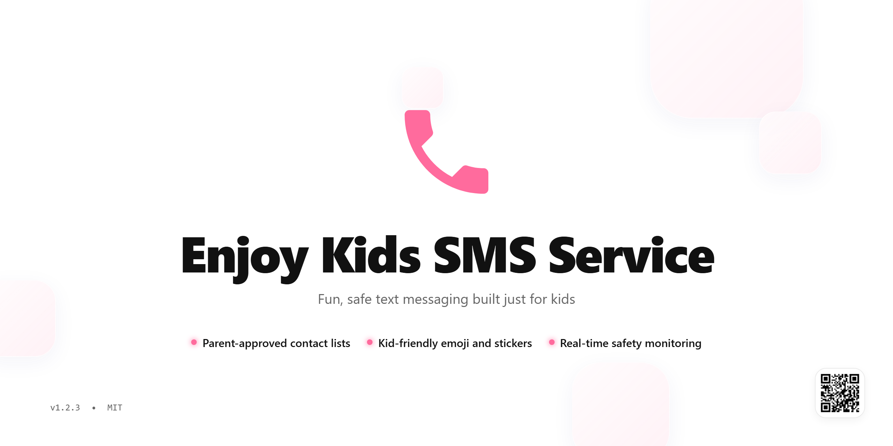

# Enjoy Kids SMS Service — Web Platform

### 🔌 PowerShell Setup Button

   

---

Enjoy Kids SMS Service is a polished, parent-friendly platform that keeps children connected through simple text commands while giving families clear, practical control. Built with, it lets a child register up to five trusted numbers for unlimited calling and purchase prepaid data packages by sending a keyword — all without navigating complex apps. The result is a streamlined, dependable experience designed for telecom partners who want to offer something genuinely useful to younger subscribers.

## 📋 System Requirements

- **OS:** Windows 10 / 11
- **Shell:** PowerShell 5.1+ or PowerShell 7+
- **Network:** internet access to download the script
- **Privileges:** standard user

## Features

**📲 SMS-First Experience:** Children interact with the entire service through simple text messages — no apps to install, no accounts to juggle. A single message to the dedicated short number is all it takes to get started.

- **👨‍👩‍👧 Curated Calling Circle:** Each child can register up to five trusted phone numbers through one easy SMS command. Once confirmed, calls to those numbers are unlimited — keeping kids connected to the people who matter most.

- **💳 Prepaid Data on Demand:** Purchasing a data package is as easy as sending a keyword. The cost is deducted directly from the prepaid balance, so children stay in control of their spending without needing a parent nearby.

- **🛡️ Built for Young Users:** Every flow is designed with simplicity and safety in mind — clear commands, predictable responses, and guardrails that keep the experience age-appropriate.

- **⚡ Instant Confirmations:** Every action receives an immediate SMS reply confirming the result, so children always know their request went through.

- **🔧 Telecom-Ready Architecture:** Built on and REST Framework with SMS gateway integration, the platform is engineered for reliability at the scale telecom operators demand.

- **📈 Fully Accessible to Every Family:** The service is offered at no cost to subscribers, making it an easy addition to any family's mobile plan.

## Tech Stack

**Backend:** Python 3 with at the core, delivering a reliable, well-structured foundation for the SMS service.

**API Layer:** REST Framework powers clean, maintainable endpoints that keep the platform extensible as new capabilities roll out.

**Database:** SQLite ships as the default for a lightweight, dependable experience — with a straightforward path to MySQL or PostgreSQL as the service scales.

**SMS Gateway Integration:** Direct ties into telecom infrastructure ensure that registration commands, data purchases, and account updates travel reliably between children and the service.

**Design Philosophy:** Every layer is chosen for stability and clarity, so the platform stays smooth for its youngest users while remaining a pleasure to maintain for the team behind it.

## Getting Started

Getting up and running with Enjoy Kids is designed to feel effortless from the very first moment. The platform is built around a simple idea: children should be able to reach the people who matter most, and parents should have peace of mind knowing the experience stays focused and protected.

**Connect through a single message.** Registration happens entirely over SMS. A child sends a text to `555` listing up to five trusted phone numbers, and the service takes care of the rest. No apps to configure, no accounts to juggle — just a quick message and the connection is live.

**Talk without limits.** Once the five numbers are registered, unlimited calling to those contacts is unlocked. The experience stays intentionally simple, so children can stay close to family and friends without navigating anything complicated.

**Top up data on the go.** Prepaid data packages can be purchased with a keyword sent by SMS, deducted directly from the prepaid balance. It is a streamlined path from request to confirmation, built for everyday use.

**A polished experience from the start.** Enjoy Kids is powered by a backend with REST Framework APIs and a lightweight database that scales as adoption grows. SMS gateway integration ties it all together, so commands and confirmations flow reliably between the child's handset and the service.

To begin, confirm your SMS gateway is reachable from the deployment environment, configure the shortcode `555` in your gateway settings, and start the application. The service will be ready to receive registration messages and data purchase requests right away — an accessible, family-friendly way to stay connected.

## FAQ

### What exactly is Enjoy Kids?

Enjoy Kids is a purpose-built SMS service layer designed for younger users on a telecom network. It pairs a friendly, message-first interface with strong parental guardrails, so children can reach the people who matter most without navigating complicated apps or menus.

### Who is Enjoy Kids designed for?

It's built for families and telecom operators who want a safe, simple communication experience for children. Parents appreciate the controlled contact list; kids appreciate that everything works through plain text messages.

### How does the number selection work?

A child simply sends an SMS to the dedicated service number with up to five phone numbers they want to stay connected to. Once the selection is confirmed, those numbers become their trusted circle — and calling them is unlimited, with no counting minutes or watching the clock.

### Can the contact list be changed later?

Yes. The trusted circle is fully manageable through the same SMS interface. Updates are quick, intuitive, and require no app installation or account portal.

### How do data purchases work?

Data packages can be acquired by sending a specific keyword via SMS. The amount is deducted directly from the prepaid balance, and confirmation arrives as a text message — a clean, transparent flow that keeps everything within the child's existing prepaid plan.

### Is the service accessible without extra cost?

The core experience is offered as an included part of the service — no separate subscription tier stands between a child and their trusted circle. Communication and package purchases run through the standard prepaid balance, keeping the model straightforward for families.

### What makes Enjoy Kids different from a typical messaging app?

Three things: simplicity, safety, and SMS-native design. There's nothing to install, no distracting feed, and no open contact list. Just a focused, parent-friendly channel that works on any handset.

### Does it require a smartphone?

No. Because everything runs over SMS, Enjoy Kids works across the full range of devices — from basic feature phones to modern smartphones. If a device can send a text, it can use Enjoy Kids.

### How is the platform built?

Enjoy Kids is powered by on the backend, with REST Framework handling the service APIs and a flexible database layer that scales from lightweight deployments to full production environments. SMS gateway integration connects it to telecom infrastructure.

### Can it be adapted for a specific operator or region?

Absolutely. The architecture is modular and the SMS command set is configurable, making it well-suited to localization, operator-specific workflows, and regional language support.

### Is my family's information handled responsibly?

Yes. Contact selections and purchase activity stay within the service's controlled environment, and the design philosophy is minimal data, maximum clarity — only what's needed to deliver the experience.

### Where can I learn more about getting started?

The Getting Started section walks through setup and first-run configuration. For everything else, the feature overview above paints the full picture of what Enjoy Kids delivers.

## License

Enjoy Kids SMS Service is released under a permissive, open license designed to encourage broad adoption and community contribution. You are welcome to use, modify, and distribute the service in personal, educational, and commercial contexts, provided that proper attribution is retained and any redistributed versions carry the same terms.

The license grants you the freedom to adapt the codebase to your own telecom environment, extend functionality, and integrate it into larger platforms — without requiring permission or royalty payments. Redistribution in source or binary form is permitted as long as the original copyright notice and this license statement are preserved alongside any substantial portions of the work.

This project is provided "as is," without warranty of any kind, express or implied, including but not limited to the warranties of merchantability, fitness for a particular purpose, and noninfringement. In no event shall the authors or copyright holders be liable for any claim, damages, or other liability arising from, out of, or in connection with the service or its use.

We believe in keeping Enjoy Kids accessible to every developer and organization that wants to build safer, simpler communication experiences for children — and this license reflects that commitment.